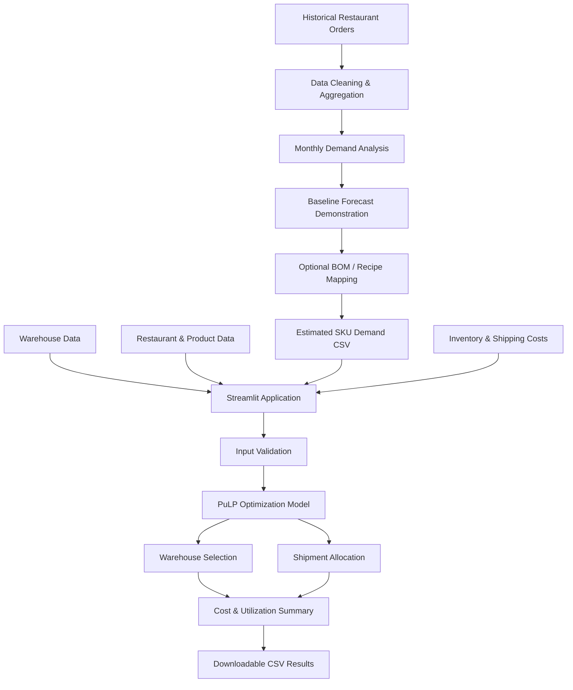

# FreshCast — Restaurant Supply Chain Optimizer

A Python-based decision-support application for restaurant distributors that combines historical demand analysis with warehouse-to-restaurant distribution optimization.

**Built with:** Python · Pandas · Streamlit · PuLP · Mixed-Integer Linear Programming

## Project Overview

FreshCast helps demonstrate how restaurant demand information and operational supply-chain data can support warehouse selection and product distribution planning.

The application provides:
- Historical restaurant order analysis and a baseline forecast demonstration.
- Optional conversion of historical sales into SKU-level demand using documented product or recipe mappings.
- Input validation for warehouse, restaurant, product, demand, inventory and shipping data.
- Cost-minimizing warehouse selection and shipment allocation.
- Interactive Streamlit dashboard with downloadable optimization results.

## Key Features

### 1. Historical Demand Analysis
- Processes historical restaurant order records.
- Aggregates orders into monthly restaurant-level demand.
- Provides a previous-month baseline forecast demonstration.
- Clearly identifies the bundled July 2021 forecast as historical, not live.

### 2. Demand Conversion
- Supports historical sales-to-demand conversion.
- Supports restaurant/SKU BOM mapping for forecast-to-ingredient demand demonstration.
- Requires documented conversion factors and normalized product units.
- Generates a downloadable `demand.csv`.

### 3. Supply Chain Optimization
- Selects warehouses using binary open/close decisions.
- Allocates product quantities from warehouses to restaurants.
- Minimizes fixed warehouse, shipping and handling costs.
- Enforces demand fulfillment, stock availability and warehouse capacity constraints.
- Reports infeasible optimization scenarios with actionable errors.

### 4. Interactive Dashboard
- Upload CSV/XLSX input files.
- Validate and preview input tables.
- Run the optimization model.
- View cost breakdown and warehouse utilization.
- Download shipment allocations and warehouse summaries.

## System Architecture



**Note:** The historical forecast and BOM conversion are demonstration workflows. The generated demand CSV is uploaded separately into the optimizer; this is not yet a fully automated end-to-end pipeline.

## Optimization Model

The objective is to minimize:

`Total Cost = Fixed Warehouse Cost + Shipping Cost + Handling Cost`

Subject to:
- All restaurant-SKU demand must be fulfilled.
- Shipment quantities cannot exceed warehouse SKU inventory.
- Total outbound quantity cannot exceed warehouse capacity.
- Only active warehouses can be selected.
- Shipment allocation is allowed only on supplied warehouse-to-restaurant shipping lanes.

The model uses PuLP with a mixed-integer linear programming formulation and the CBC solver.

## Required Input Data

| Input file | Purpose |
|---|---|
| `warehouses.csv` | Warehouse capacity, fixed cost and active status |
| `restaurants.csv` | Restaurant destinations |
| `products.csv` | SKU and base-unit definitions |
| `demand.csv` | Required quantity per restaurant and SKU |
| `inventory.csv` | Warehouse-level SKU stock and handling cost |
| `shipping_costs.csv` | Shipping cost per base unit and delivery lane |

All six input tables must use a consistent planning period and currency. Product quantities must be normalized to the declared base unit.

## Technology Stack

- **Language:** Python
- **Data Processing:** Pandas
- **Optimization:** PuLP, Mixed-Integer Linear Programming
- **Dashboard:** Streamlit
- **Data Formats:** CSV, Excel
- **Testing:** Pytest
- **Version Control:** Git and GitHub
- **Containerization:** Docker configuration included

## Run Locally

### 1. Clone the repository

```bash
git clone https://github.com/abhishek1514/FreshCast-Supply-Chain-Optimizer.git
cd FreshCast-Supply-Chain-Optimizer
```

### 2. Create a virtual environment

```bash
python -m venv .venv
```

Windows PowerShell:

```powershell
.venv\Scripts\Activate.ps1
```

### 3. Install dependencies

```bash
python -m pip install -r requirements.txt
```

### 4. Run the application

```bash
streamlit run app.py
```

Open `http://localhost:8501` in your browser.

## Run Tests

```bash
python -m pytest -q
```

The current test suite contains 8 passing tests covering optimization, demand conversion and input validation.

## Project Structure

```text
FreshCast-Supply-Chain-Optimizer/
│
├── app.py
├── app/
│   ├── io.py
│   ├── optimizer.py
│   ├── public_demand.py
│   └── schema.py
│
├── data/
│   ├── public/
│   └── templates/
│
├── docs/
│   ├── DATA_SOURCES.md
│   └── PUBLIC_DATA_MAPPING.md
│
├── tests/
│   ├── test_optimizer.py
│   ├── test_public_demand.py
│   └── test_schema.py
│
├── requirements.txt
├── Dockerfile
├── render.yaml
└── README.md
```

## Data Sources and Limitations

The public restaurant order dataset covers January 2019 to June 2021. Its bundled forecast is a historical demonstration for July 2021, not a current forecast.

Restaurant order counts do not directly represent ingredient quantities. A documented recipe/BOM mapping is needed to estimate SKU-level demand.

The optimizer requires verified operational inputs for inventory, warehouse capacity, fixed costs, handling costs and shipping rates. These values must be provided by the operator; the public dataset does not establish them.

The current model assumes deterministic demand and known operational inputs. It does not currently model spoilage, delivery time windows, minimum order quantities or multi-period inventory carry-over.

## Future Improvements

- Integrate forecasting and optimization into one automated workflow.
- Evaluate forecasting models at restaurant level.
- Add real-time operational data integration.
- Introduce multi-period inventory planning.
- Add delivery lead-time and route constraints.
- Improve dashboard reporting and scenario comparison.

## Author

**Abhishek babu**  
B.Tech — Artificial Intelligence & Machine Learning

GitHub: https://github.com/abhishek1514

---

*FreshCast is an academic decision-support prototype. Validate all operational inputs and optimization outputs before using them for real distribution decisions.*
